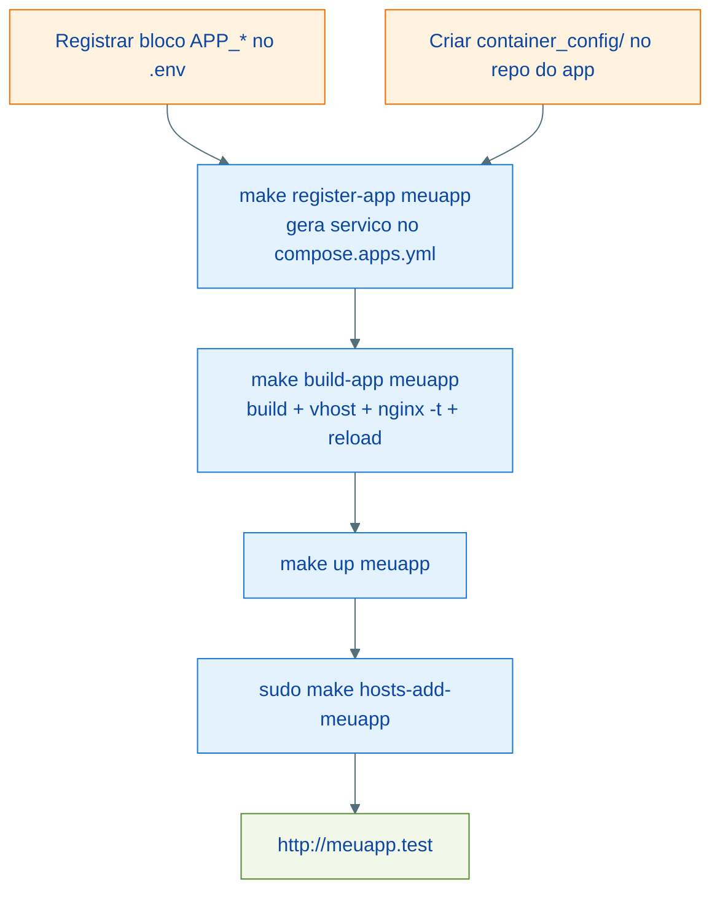

# Arquitetura: Registro de Aplicações

As aplicações não vivem neste repositório — vivem em seus próprios repositórios e são "plugadas" na infraestrutura por dois pontos de contato: um bloco de variáveis no `.env` e uma pasta de configuração de container no repositório do app. O serviço Docker Compose do app é **gerado** por `make register-app`, num arquivo local não versionado (`compose.apps.yml`) — o `.env` é a única fonte de verdade.

---

## Contrato do app

### 1. Bloco no `.env`

```dotenv
# App: MEUAPP
MEUAPP_NGINX_MODE=php
MEUAPP_CONTAINER_NAME=meuapp
MEUAPP_PROJECT_PATH=/Users/voce/Projects/meuapp
MEUAPP_DOCKER_PATH=/var/www
MEUAPP_ALIASES="meuapp.test meuapp.docker.local"
MEUAPP_PORT=8000
```

O prefixo (`MEUAPP`) é derivado do nome do app em maiúsculas com hífens virando underscore (`meu-app` vira `MEU_APP`). Variáveis opcionais:

| Variável | Efeito |
| --- | --- |
| `MEUAPP_NGINX_ROOT` | Root do vhost nos modos `php`/`html` (default: ver "Root do vhost" abaixo) |
| `MEUAPP_PHP_UPSTREAM` | Upstream FastCGI (default `php-fpm:9000`) |

### 2. Pasta `container_config/` no repositório do app

| Arquivo | Papel |
| --- | --- |
| `Dockerfile` | Imagem do app — tipicamente `ARG BASE_IMAGE` + `FROM ${BASE_IMAGE}` (o registro passa a imagem base local automaticamente) |
| `entrypoint.sh` | Bootstrap (migrations, cache, permissions) |
| `supervisord.conf` | Processos do app: server, queue workers, Horizon, Reverb |

O nome da pasta é configurável via `APP_CONTAINER_CFG_DIR` no `.env` (default: `container_config`). Modelo funcional completo em [`examples/demo-app/container_config/`](../examples/demo-app/container_config/).

### 3. Registro (gerado, não manual)

```bash
make register-app meuapp
```

Gera o bloco de serviço em `compose.apps.yml` a partir de `templates/compose-app.yml`, delimitado por marcadores (`# app:meuapp:begin` / `# app:meuapp:end`), e valida com `docker compose config`. O `.env` define `COMPOSE_FILE=docker-compose.yml:compose.apps.yml`, então o compose enxerga o serviço imediatamente. `make unregister-app meuapp` remove o bloco. Registrar de novo substitui (idempotente).

Para necessidades além do template (portas publicadas, envs extras, healthcheck próprio), edite o bloco gerado no `compose.apps.yml` — ele é seu, não é sobrescrito a menos que você rode `register-app` de novo.

---

## Modos de integração com o Nginx

| `NGINX_MODE` | Comportamento | Quando usar |
| --- | --- | --- |
| `none` | Nenhum vhost gerado | Workers, CLIs, apps sem HTTP |
| `php` | Vhost FastCGI apontando para o php-fpm compartilhado | Laravel/PHP servido pelo php-fpm base |
| `proxy` | Proxy reverso para `CONTAINER:PORT` (websocket-ready, DNS resolvido por requisição) | Apps com server próprio: Octane, Reverb, Node |
| `html` | Servir arquivos estáticos do root | SPAs buildadas, sites estáticos |

Modos WordPress têm alvo próprio (`make wordpress-conf`), fora do ciclo `build-app`.

### Root do vhost (modos `php` e `html`)

O root precisa ser um caminho válido **dentro dos containers nginx e php-fpm**, onde `LOCAL_DIR` está montado em `DOCKER_PROJECT_PATH` (default `/var/www`). Derivação automática:

1. `MEUAPP_NGINX_ROOT` do `.env`, se definido.
1. Modo `php`: `DOCKER_PROJECT_PATH/<app>/public` (convenção Laravel).
1. Modo `html`: `DOCKER_PROJECT_PATH/<app>`.

---

## Ciclo de vida



Comandos do dia a dia, depois do app no ar:

```bash
make shell-meuapp        # zsh dentro do container (sufixo = container name)
make artisan-meuapp      # php artisan
make composer-meuapp     # composer
make queue-meuapp        # php artisan queue:work
make reload-meuapp       # restart so deste container
make logs                # logs de tudo
```

Atenção à sintaxe: esses alvos usam **sufixo com hífen** e recebem o **nome do container**. Detalhes em [comandos.md](./comandos.md).

---

## Como os apps enxergam a infraestrutura

Dentro da rede `phpdocker-network`, os serviços respondem pelos aliases do `.env`. Num `.env` de app Laravel (com os nomes do `.env.example`):

```dotenv
DB_HOST=makephp-mariadb
REDIS_HOST=makephp-redis
RABBITMQ_HOST=makephp-rabbitmq
```

Os valores devem casar com `MARIADB_ALIASES`, `REDIS_ALIASES`, etc. Bancos adicionais por app: copie `mariadb/docker-entrypoint-initdb.d/createdb.sql.example` para `createdb.sql` (mesma pasta, não versionado) e ajuste — roda na primeira inicialização do volume.

---

## Checklist: adicionar um app novo

1. Criar `container_config/` (Dockerfile + entrypoint.sh + supervisord.conf) no repositório do app.
1. Adicionar o bloco `<APP>_*` no `.env` deste repositório, escolhendo o `NGINX_MODE`.
1. `make register-app <app>` — gera o serviço compose.
1. `make build-app <app>` — build da imagem + vhost validado + reload do nginx.
1. `make up <app>` — sobe o container.
1. `sudo make hosts-add-<app>` — aliases locais.
1. Validar: `make ps`, abrir `http://<alias>` (ou `make smoke` para a validação completa da stack).

---

## Referências

| Arquivo | Responsabilidade |
| --- | --- |
| `.env` / `.env.example` | Registro dos apps (fonte de verdade) |
| `templates/compose-app.yml` | Template do serviço gerado |
| `compose.apps.yml` | Serviços gerados (local, não versionado) |
| `makefiles/apps.mk` | `register-app`, `unregister-app` |
| `makefiles/nginx.mk` | `build-app`, `generate-nginx-conf-%`, `nginx-reload-safe` |
| `examples/demo-app/` | App de exemplo com o contrato completo |
| [nginx-ssl.md](./nginx-ssl.md) | Como o vhost do app é gerado |
