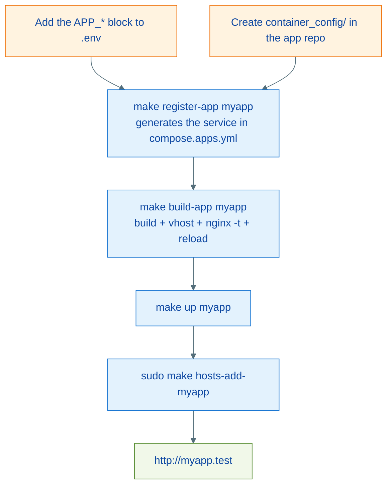

# Architecture: Application Registration

Applications do not live in this repository — they live in their own repositories and plug into the infrastructure through two contact points: a variable block in `.env` and a container configuration folder in the app repository. The app's Docker Compose service is **generated** by `make register-app` into a local, unversioned file (`compose.apps.yml`) — `.env` is the single source of truth.

---

## The app contract

### 1. Block in `.env`

```dotenv
# App: MYAPP
MYAPP_NGINX_MODE=php
MYAPP_CONTAINER_NAME=myapp
MYAPP_PROJECT_PATH=/Users/you/Projects/myapp
MYAPP_DOCKER_PATH=/var/www
MYAPP_ALIASES="myapp.test myapp.docker.local"
MYAPP_PORT=8000
```

The prefix (`MYAPP`) derives from the app name uppercased with hyphens turned into underscores (`my-app` becomes `MY_APP`). Optional variables:

| Variable | Effect |
| --- | --- |
| `MYAPP_NGINX_ROOT` | Vhost root for `php`/`html` modes (default: see "Vhost root" below) |
| `MYAPP_PHP_UPSTREAM` | FastCGI upstream (default `php-fpm:9000`) |

### 2. `container_config/` folder in the app repository

| File | Role |
| --- | --- |
| `Dockerfile` | The app image — typically `ARG BASE_IMAGE` + `FROM ${BASE_IMAGE}` (registration passes the local base image automatically) |
| `entrypoint.sh` | Bootstrap (migrations, cache, permissions) |
| `supervisord.conf` | App processes: server, queue workers, Horizon, Reverb |

The folder name is configurable via `APP_CONTAINER_CFG_DIR` in `.env` (default: `container_config`). A complete working template lives in [`examples/demo-app/container_config/`](../examples/demo-app/container_config/).

### 3. Registration (generated, not manual)

```bash
make register-app myapp
```

Generates the service block in `compose.apps.yml` from `templates/compose-app.yml`, delimited by markers (`# app:myapp:begin` / `# app:myapp:end`), and validates with `docker compose config`. `.env` sets `COMPOSE_FILE=docker-compose.yml:compose.apps.yml`, so compose sees the service immediately. `make unregister-app myapp` removes the block. Registering again replaces it (idempotent).

For anything beyond the template (published ports, extra envs, a custom healthcheck), edit the generated block in `compose.apps.yml` — it is yours and is only rewritten if you run `register-app` again.

---

## Nginx integration modes

| `NGINX_MODE` | Behavior | When to use |
| --- | --- | --- |
| `none` | No vhost generated | Workers, CLIs, apps without HTTP |
| `php` | FastCGI vhost pointing at the shared php-fpm | Laravel/PHP served by the base php-fpm |
| `proxy` | Reverse proxy to `CONTAINER:PORT` (websocket-ready, per-request DNS resolution) | Apps with their own server: Octane, Reverb, Node |
| `html` | Static files from the root | Built SPAs, static sites |

WordPress modes have their own target (`make wordpress-conf`), outside the `build-app` cycle.

### Vhost root (`php` and `html` modes)

The root must be a valid path **inside the nginx and php-fpm containers**, where `LOCAL_DIR` is mounted at `DOCKER_PROJECT_PATH` (default `/var/www`). Automatic derivation:

1. `MYAPP_NGINX_ROOT` from `.env`, when set.
1. `php` mode: `DOCKER_PROJECT_PATH/<app>/public` (Laravel convention).
1. `html` mode: `DOCKER_PROJECT_PATH/<app>`.

---

## Lifecycle



Day-to-day commands once the app is up:

```bash
make shell-myapp         # zsh inside the container (suffix = container name)
make artisan-myapp       # php artisan
make composer-myapp      # composer
make queue-myapp         # php artisan queue:work
make reload-myapp        # restart only this container
make logs                # logs from everything
```

Mind the syntax: these targets use a **dash suffix** and take the **container name**. Details in [commands.md](./commands.md).

---

## How apps see the infrastructure

Inside the `phpdocker-network` network, services answer by the aliases from `.env`. In a Laravel app `.env` (with the names from `.env.example`):

```dotenv
DB_HOST=makephp-mariadb
REDIS_HOST=makephp-redis
RABBITMQ_HOST=makephp-rabbitmq
```

The values must match `MARIADB_ALIASES`, `REDIS_ALIASES`, etc. Extra per-app databases: copy `mariadb/docker-entrypoint-initdb.d/createdb.sql.example` to `createdb.sql` (same folder, unversioned) and adjust — it runs on the first initialization of the data volume.

---

## Checklist: adding a new app

1. Create `container_config/` (Dockerfile + entrypoint.sh + supervisord.conf) in the app repository.
1. Add the `<APP>_*` block to this repository's `.env`, picking the `NGINX_MODE`.
1. `make register-app <app>` — generates the compose service.
1. `make build-app <app>` — image build + validated vhost + nginx reload.
1. `make up <app>` — starts the container.
1. `sudo make hosts-add-<app>` — local aliases.
1. Verify: `make ps`, open `http://<alias>` (or `make smoke` for the full stack validation).

---

## References

| File | Responsibility |
| --- | --- |
| `.env` / `.env.example` | App registration (source of truth) |
| `templates/compose-app.yml` | Generated service template |
| `compose.apps.yml` | Generated services (local, unversioned) |
| `makefiles/apps.mk` | `register-app`, `unregister-app` |
| `makefiles/nginx.mk` | `build-app`, `generate-nginx-conf-%`, `nginx-reload-safe` |
| `examples/demo-app/` | Example app with the full contract |
| [nginx-ssl.md](./nginx-ssl.md) | How the app vhost is generated |
