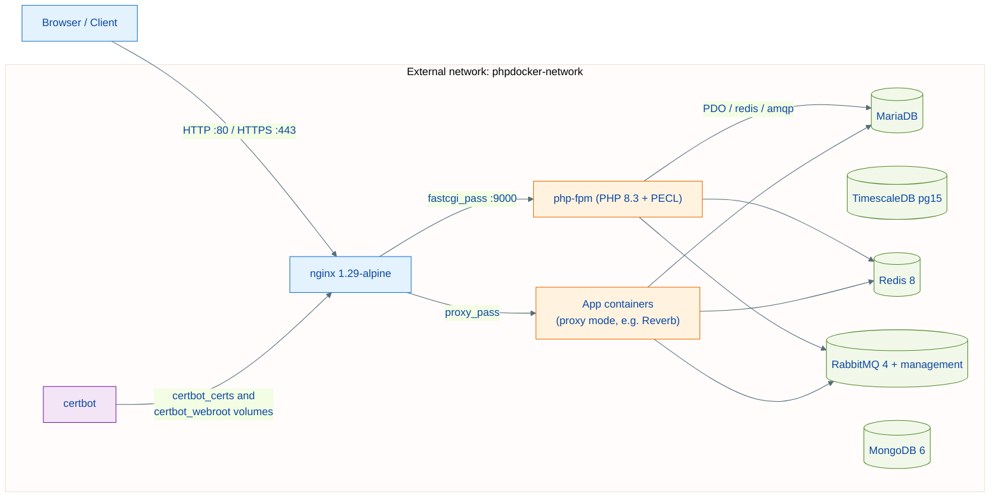
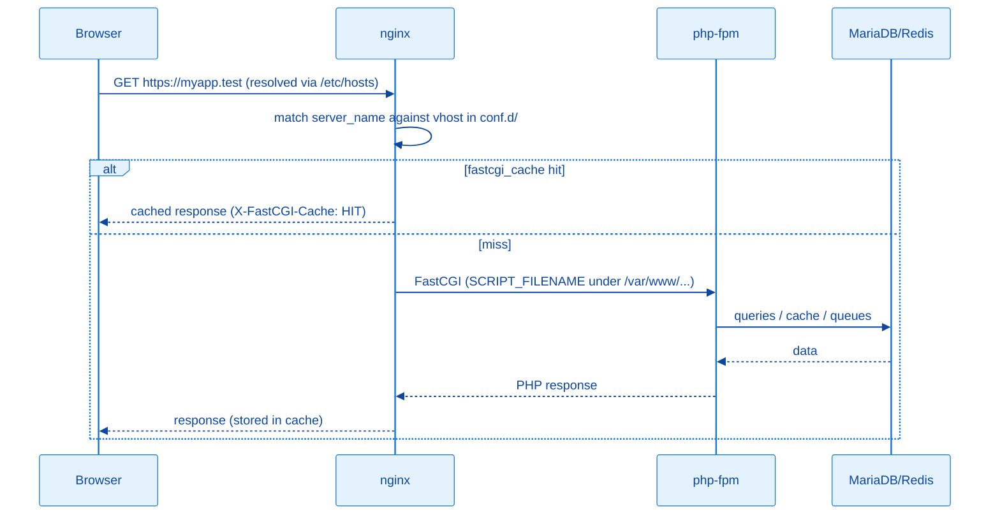

# Architecture: Overview

Makefile-driven Docker environment for PHP applications, designed to serve both local development (macOS/Linux) and a single-node production host (Debian). The core principle:

- **Infrastructure lives in this repository**: databases, cache, queues, reverse proxy and certificate issuance.
- **Applications live in their own repositories**: each app declares a `container_config/` folder (Dockerfile, entrypoint, supervisord) and is registered in this project's `.env` through the `<APP>_*` naming convention.

---

## Service topology



The `phpdocker-network` network is **external** to compose — it must exist before the first `make up` (`make init` creates it):

```bash
docker network create phpdocker-network
```

This lets app containers defined in other compose files (or manually) join the same network and resolve services by the aliases declared in `.env` (`MARIADB_ALIASES`, `REDIS_ALIASES`, etc.).

---

## Services and port exposure

| Service | Image | Host port | Notes |
| --- | --- | --- | --- |
| nginx | `nginx:1.29-alpine` | `NGINX_PORT_HTTP:80`, `NGINX_PORT_HTTPS:443` | Single public entry point; healthcheck at `/healthz` |
| php-fpm | local build `php/Dockerfile` (target `final`) | — (internal network only) | Shared base for `php`-mode sites |
| mariadb | local build `mariadb/` (`mariadb:12.2`) | `127.0.0.1:MARIADB_PORT` | Tuned `my.cnf`; authentication enforced |
| redis | `redis:8-alpine` | `127.0.0.1:REDIS_PORT` | `requirepass` from `.env`; authenticated healthcheck |
| rabbitmq | `rabbitmq:4-management` | `127.0.0.1` (5672 and 15672) | Credentials via `RABBITMQ_USER`/`RABBITMQ_PASSWORD` |
| postgres-timescale | `timescale/timescaledb:2.28.3-pg15` | `127.0.0.1:POSTGRES_TIMESCALE_PORT` | Time-series data; `pg_isready` healthcheck |
| mongodb | `mongo:6.0` | `127.0.0.1:MONGODB_PORT` | **Not** started by the default `make up`; root user from `.env` |
| certbot | local build `certbot/` (`certbot:v5.7.0`) | — | Run on demand (`make cert-gen`, `cert-renew`) |

All infrastructure binds to loopback; only nginx publishes on all interfaces. `make up` starts `php-fpm nginx mariadb redis rabbitmq postgres-timescale` — MongoDB is opt-in (`make up mongodb`). nginx and php-fpm logs land in `./logs/` (created by `make init`).

---

## Multi-stage PHP image (dev and prod)

`php/Dockerfile` chains stages to maximize layer caching and exposes two final targets: `final` (dev, full-featured) and `prod` (slim runtime that copies the compiled extensions from the builder — no gcc, node, python or terminal tools). Both are published to `giacomeli/makephp` (`8.3-dev` / `8.3-prod`, amd64+arm64):

```mermaid
%%{init: {'theme':'base','themeVariables':{'primaryColor':'#E3F2FD','primaryTextColor':'#0D47A1','primaryBorderColor':'#1976D2','lineColor':'#546E7A'}}}%%
flowchart LR
    accTitle: PHP image build stages
    accDescr: Linear chain of Docker stages from the base system to the final dev image with Composer and dotfiles. The Swoole stage is conditional on a build arg. The prod target copies the compiled extensions into a clean runtime.

    classDef stage fill:#E3F2FD,stroke:#1976D2
    classDef cond fill:#FFF3E0,stroke:#EF6C00
    classDef prod fill:#F1F8E9,stroke:#558B2F

    A["system-base<br>zsh, git, networking"]:::stage --> B["dev-tools<br>gcc, node, npm"]:::stage
    B --> C["php-libs<br>extension libraries"]:::stage
    C --> D["terminal-tools<br>vim, tmux, supervisor"]:::stage
    D --> E["python-env<br>venv for scripts"]:::stage
    E --> F["php-extensions<br>gd, intl, pdo_mysql, pdo_pgsql..."]:::stage
    F --> G["php-pecl<br>mongodb, redis, amqp, apcu, imagick"]:::stage
    G --> H["php-swoole<br>conditional: PHP_ENABLE_SWOOLE"]:::cond
    H --> I["final (DEV)<br>conditional Xdebug, Composer,<br>Oh My Zsh, dotfiles"]:::stage
    H -- "COPY compiled extensions" --> J["prod<br>clean php:8.3-fpm + runtime libs<br>+ php-prod.ini + Composer"]:::prod
```



Notes:

- `PHP_ENABLE_SWOOLE=true` and `PHP_ENABLE_XDEBUG=true` in `.env` control the conditional stages — `make build` and compose forward the build args. Xdebug exists only in the dev image; its runtime mode comes from `XDEBUG_ENABLE` (the `XDEBUG_MODE` env).
- Per-environment `php.ini`: `php/php-dev.ini` (mounted into the local php-fpm) and `php/php-prod.ini` (baked into the prod target, with `opcache.validate_timestamps=0`).
- The prod image validates at build time that every extension loads (`php -m`) — native builds only, since running php under QEMU emulation segfaults.

---

## Orchestration layers (Makefile)

The main `Makefile` loads `.env`, defines `SED_INPLACE` (macOS/Linux compatibility) and includes four modules:

| Module | Responsibility |
| --- | --- |
| `makefiles/php.mk` | Image builds (dev/prod), DockerHub publishing, per-container helpers |
| `makefiles/nginx.mk` | App builds, validated nginx vhost generation, certificate lifecycle |
| `makefiles/apps.mk` | `register-app`/`unregister-app` (app compose generation) |
| `makefiles/system.mk` | `init`, `up`/`down`/`restart`/`logs`, `smoke`, `/etc/hosts`, cleanup |

Argument syntax varies per target (positional, dash suffix, `name=`) — detailed in [commands.md](./commands.md).

---

## Anatomy of a PHP request



The FastCGI cache is enabled in the PHP templates with an automatic session-cookie bypass — authenticated pages are never served from cache.

---

## References

| File | Responsibility |
| --- | --- |
| `docker-compose.yml` | All services, volumes and network |
| `php/Dockerfile` | Multi-stage PHP image |
| `nginx/nginx.conf` | Global proxy config (gzip, TLS, cache, headers) |
| `Makefile` + `makefiles/*.mk` | Orchestration |
| [nginx-ssl.md](./nginx-ssl.md) | Template system and certificates |
| [apps.md](./apps.md) | Application registration and lifecycle |
| [production.md](./production.md) | Production host operation |
| [commands.md](./commands.md) | Full Makefile reference |
