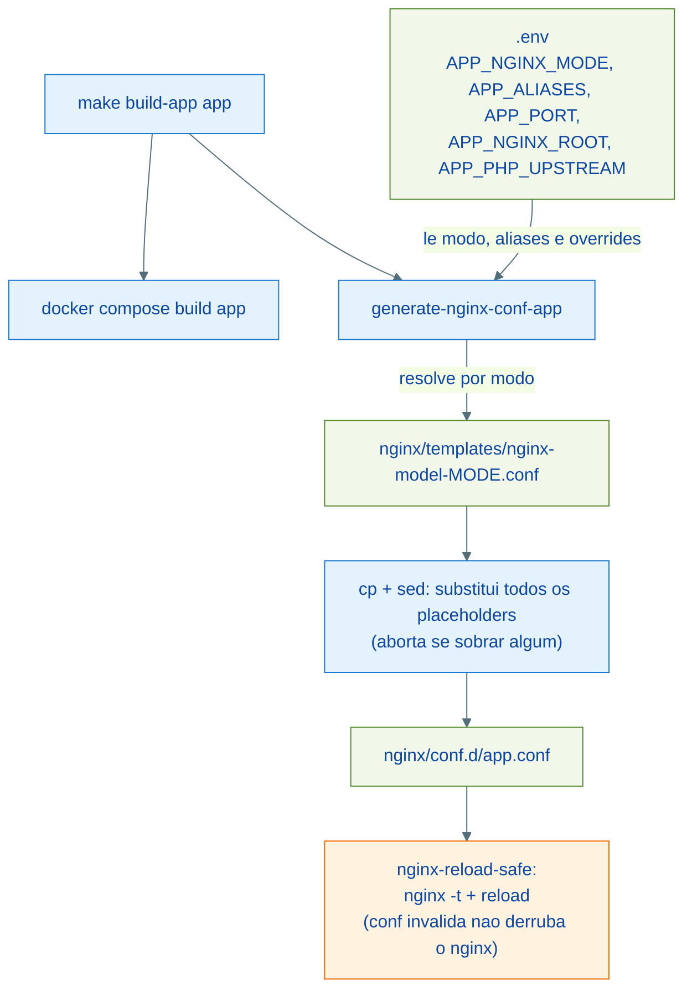
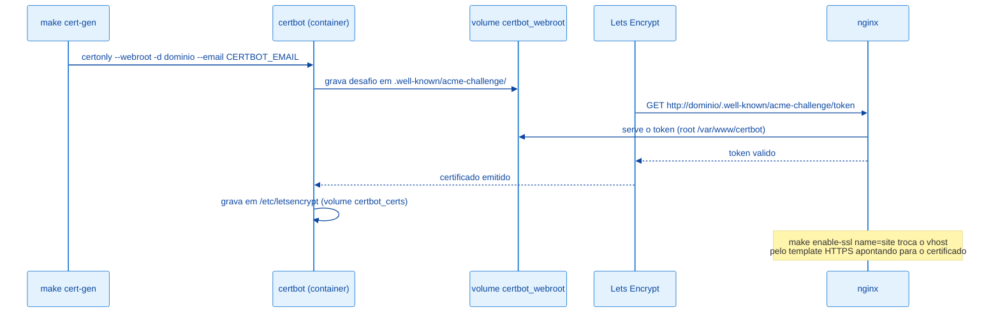

# Arquitetura: Nginx e SSL

O Nginx é o único ponto de entrada do ambiente. Os vhosts não são escritos à mão: são **gerados** a partir de templates com placeholders, alimentados pelas variáveis `<APP>_*` do `.env` ou por parâmetros `name=`/`domain=` do Makefile. O ciclo de certificados usa Certbot em container, no modo webroot, com renovação automatizada por systemd no host de produção.

---

## Config global (`nginx/nginx.conf`)

Montada por bind sobre a imagem stock `nginx:1.29-alpine`. Destaques:

| Bloco | O que faz |
| --- | --- |
| `fastcgi_cache_path ... keys_zone=FASTCGI_CACHE:10m` | Zona de cache FastCGI compartilhada pelos vhosts PHP (volume `fastcgi-cache`) |
| `open_file_cache max=10000` | Cache de descritores para sites estáticos |
| `gzip` + tipos | Compressão para texto/JSON/SVG/fontes |
| `ssl_protocols TLSv1.2 TLSv1.3` + ciphers ECDHE | Baseline TLS para todos os vhosts HTTPS |
| Security headers | Centralizados em `nginx/includes/security-headers.conf`, incluídos nos server blocks E nos locations com `add_header` próprio (a herança do nginx descarta headers herdados nesses contextos) |
| `server { listen 80 default_server; return 444; }` | Host desconhecido não recebe conteúdo (apenas `/healthz` responde, para o healthcheck do compose) |
| `server { listen 443 ssl default_server; ssl_reject_handshake on; }` | SNI desconhecido não recebe o certificado de nenhum site |
| `include /etc/nginx/conf.d/*.conf` | Único ponto de carga dos vhosts — `sites-available/` guarda configs locais/produção fora do git e não é lido pelo nginx |

---

## Templates e placeholders

Os templates vivem em `nginx/templates/` (`make nginx-templates` lista):

| Template | Uso | Placeholders |
| --- | --- | --- |
| `nginx-model-php.conf` | Laravel/PHP via FastCGI (HTTP) | `__SERVER_NAME__`, `__ROOT_PATH__`, `__APP_NAME__` |
| `nginx-model-php-https.conf` | Laravel/PHP com redirect HTTPS | anteriores + `__CERT_DOMAIN__`, `__PHP_UPSTREAM__` |
| `nginx-model-proxy.conf` | Proxy reverso (Reverb, websockets, apps com server próprio) | `__SERVER_NAME__`, `__APP_NAME__`, `__APP_PORT__` |
| `nginx-model-html.conf` | Estáticos | `__SERVER_NAME__`, `__ROOT_PATH__`, `__APP_NAME__` |
| `nginx-model-wordpress-http.conf` | WordPress HTTP | `__SERVER_NAME__`, `__ROOT_PATH__`, `__APP_NAME__`, `__PHP_UPSTREAM__` |
| `nginx-model-wordpress-https.conf` | WordPress HTTPS | anteriores + `__CERT_DOMAIN__` |

Características comuns dos templates:

- Primeira linha com a sentinela `# generated-by: makephp` — herdada pelos configs gerados; é o que permite ao `make clean-confs` remover apenas o que foi gerado, preservando configs manuais.
- Todos escutam a porta **80** dentro do container (a porta externa é escolhida em `NGINX_PORT_HTTP` no `.env`).
- `location ~ /.well-known/acme-challenge` apontando para `/var/www/certbot` — emite/renova certificados sem derrubar o site.
- Templates PHP/WordPress: cache FastCGI com **bypass por cookie de sessão** (`laravel_session`, `wordpress_logged_in`, `PHPSESSID`) — páginas autenticadas nunca são cacheadas.
- Template proxy: `resolver 127.0.0.11` + `proxy_pass` via variável — o DNS do container do app é resolvido por requisição, então o nginx sobe (e o `nginx -t` passa) mesmo com o app fora do ar.

---

## Fluxo de geração de config



Três formas de gerar um vhost:

```bash
# 1. A partir do registro do app no .env (usa <APP>_NGINX_MODE)
make build-app meuapp

# 2. Manualmente, a partir de qualquer template
make nginx-conf template=proxy name=meusite domain=meusite.test port=8000

# 3. Atalhos por tipo
make nginx-html-conf name=docs domain=docs.test root=/var/www/docs/dist
make wordpress-conf name=blog domain=blog.com.br
```

`make nginx-list` mostra um resumo de todos os vhosts em `conf.d/` com domínio, root, porta e status de SSL.

---

## Emissão de certificado (Certbot, modo webroot)



Sequência típica para colocar um site em HTTPS:

```bash
# Pré-requisito: vhost HTTP existente respondendo pelo domínio (DNS apontado)
make cert-gen-www domain=exemplo.com.br      # emite para exemplo.com.br + www
make enable-ssl name=exemplo                 # troca o vhost pelo template HTTPS
```

O `enable-ssl` preserva `root`, `server_name` e `fastcgi_pass` do config atual, detecta se o site é PHP (presença de `fastcgi_pass`) para escolher entre `php-https` e `wordpress-https`, e aceita overrides: `root=`, `domain=`, `cert_domain=`, `php_upstream=`, `template=`.

Variáveis no `.env`: `CERTBOT_EMAIL` (obrigatória) e `CERTBOT_STAGING=1` (usar o ambiente de teste do Let's Encrypt durante experimentos, evita rate limit).

---

## Renovação automática

Um único caminho: `make cert-renew` renova via container certbot **e recarrega o nginx**. A automação de produção é o mesmo comando agendado:

| Camada | Papel |
| --- | --- |
| `make cert-renew` | Renova certificados e recarrega o nginx (manual ou agendado) |
| `scripts/cert-renew.sh` | Wrapper para o systemd: resolve o diretório do projeto (`PHPDOCKER_DIR`, com default relativo ao script) e chama `make cert-renew` |
| `systemd/certbot-renew.timer` + `.service` | Agenda 2x/dia (03:14 e 15:14, jitter de até 1h); user/paths ajustáveis no unit |

Instalação no host de produção descrita em [producao.md](./producao.md).

---

## Como adicionar um novo template

1. Criar `nginx/templates/nginx-model-<nome>.conf` com a primeira linha `# generated-by: makephp` (sem ela, o `clean-confs` não gerencia os configs gerados) e os placeholders existentes (`__SERVER_NAME__`, `__ROOT_PATH__`, `__APP_NAME__`, `__APP_PORT__`, `__CERT_DOMAIN__`, `__PHP_UPSTREAM__`).
1. Escutar a porta 80 (HTTP) e/ou 443 (HTTPS) — a porta externa vem do `.env`.
1. Incluir `include /etc/nginx/includes/security-headers.conf;` no server block (e em qualquer location que declare `add_header` próprio).
1. Incluir o bloco ACME (`location ~ /.well-known/acme-challenge`) se o site puder ganhar HTTPS depois.
1. Usar via `make nginx-conf template=<nome> name=...` — a resolução aceita o nome curto (`proxy`), o nome completo (`nginx-model-proxy.conf`) ou `<nome>.conf`.
1. Para o template ser usado como `NGINX_MODE`, o valor do modo no `.env` deve casar com o sufixo do arquivo (`<APP>_NGINX_MODE=<nome>`).
1. Validar: `make nginx-reload-safe` (roda `nginx -t` dentro do container antes de recarregar).

---

## Referências

| Arquivo | Responsabilidade |
| --- | --- |
| `nginx/nginx.conf` | Config global |
| `nginx/includes/security-headers.conf` | Headers compartilhados |
| `nginx/templates/` | Templates-fonte (com sentinela de geração) |
| `nginx/conf.d/` | Vhosts gerados (carregados pelo nginx) |
| `makefiles/nginx.mk` | Alvos de geração, SSL, certificados e `nginx-reload-safe` |
| `certbot/Dockerfile` | Container Certbot (versão pinada) |
| `scripts/cert-renew.sh`, `systemd/` | Renovação automatizada |
