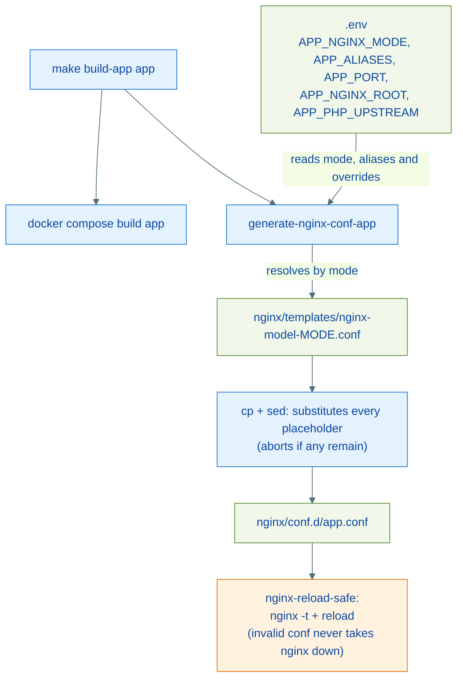

# Architecture: Nginx and SSL

Nginx is the environment's single entry point. Vhosts are not written by hand: they are **generated** from templates with placeholders, fed by the `<APP>_*` variables in `.env` or by `name=`/`domain=` Makefile parameters. The certificate lifecycle uses containerized Certbot in webroot mode, with renewal automated by systemd on the production host.

---

## Global config (`nginx/nginx.conf`)

Bind-mounted over the stock `nginx:1.29-alpine` image. Highlights:

| Block | What it does |
| --- | --- |
| `fastcgi_cache_path ... keys_zone=FASTCGI_CACHE:10m` | FastCGI cache zone shared by the PHP vhosts (`fastcgi-cache` volume) |
| `open_file_cache max=10000` | Descriptor cache for static sites |
| `gzip` + types | Compression for text/JSON/SVG/fonts |
| `ssl_protocols TLSv1.2 TLSv1.3` + ECDHE ciphers | TLS baseline for every HTTPS vhost |
| Security headers | Centralized in `nginx/includes/security-headers.conf`, included in server blocks AND in locations with their own `add_header` (nginx inheritance discards inherited headers there) |
| `server { listen 80 default_server; return 444; }` | Unknown hosts get no content (only `/healthz` answers, for the compose healthcheck) |
| `server { listen 443 ssl default_server; ssl_reject_handshake on; }` | Unknown SNI gets no site certificate |
| `include /etc/nginx/conf.d/*.conf` | Single vhost load point — `sites-available/` holds local/production configs outside git and is not read by nginx |

---

## Templates and placeholders

Templates live in `nginx/templates/` (`make nginx-templates` lists them):

| Template | Use | Placeholders |
| --- | --- | --- |
| `nginx-model-php.conf` | Laravel/PHP via FastCGI (HTTP) | `__SERVER_NAME__`, `__ROOT_PATH__`, `__APP_NAME__`, `__PHP_UPSTREAM__` |
| `nginx-model-php-https.conf` | Laravel/PHP with HTTPS redirect | previous + `__CERT_DOMAIN__` |
| `nginx-model-proxy.conf` | Reverse proxy (Reverb, websockets, apps with their own server) | `__SERVER_NAME__`, `__APP_NAME__`, `__APP_PORT__` |
| `nginx-model-html.conf` | Static files | `__SERVER_NAME__`, `__ROOT_PATH__`, `__APP_NAME__` |
| `nginx-model-wordpress-http.conf` | WordPress HTTP | `__SERVER_NAME__`, `__ROOT_PATH__`, `__APP_NAME__`, `__PHP_UPSTREAM__` |
| `nginx-model-wordpress-https.conf` | WordPress HTTPS | previous + `__CERT_DOMAIN__` |

Shared template characteristics:

- First line carries the `# generated-by: makephp` sentinel — inherited by generated configs; it is what lets `make clean-confs` remove only generated files while preserving manual ones.
- All listen on port **80** inside the container (the external port is chosen via `NGINX_PORT_HTTP` in `.env`).
- `location ~ /.well-known/acme-challenge` pointing at `/var/www/certbot` — issues/renews certificates without taking the site down.
- PHP/WordPress templates: FastCGI cache with a **session-cookie bypass** (`laravel_session`, `wordpress_logged_in`, `PHPSESSID`) — authenticated pages are never cached.
- Proxy template: `resolver 127.0.0.11` + variable `proxy_pass` — the app container's DNS is resolved per request, so nginx starts (and `nginx -t` passes) even with the app down.

---

## Vhost generation flow



Three ways to generate a vhost:

```bash
# 1. From the app registration in .env (uses <APP>_NGINX_MODE)
make build-app myapp

# 2. Manually, from any template
make nginx-conf template=proxy name=mysite domain=mysite.test port=8000

# 3. Per-type shortcuts
make nginx-html-conf name=docs domain=docs.test root=/var/www/docs/dist
make wordpress-conf name=blog domain=blog.example.com
```

`make nginx-list` shows a summary of every vhost in `conf.d/` with domain, root, port and SSL status.

---

## Certificate issuance (Certbot, webroot mode)


Typical sequence to move a site to HTTPS:

```bash
# Prerequisite: an HTTP vhost answering for the domain (DNS pointed here)
make cert-gen-www domain=example.com             # issues for example.com + www
make enable-ssl name=example                     # swaps the vhost for the HTTPS template
```

`enable-ssl` preserves `root`, `server_name` and `fastcgi_pass` from the current config, detects whether the site is PHP (presence of `fastcgi_pass`) to pick between `php-https` and `wordpress-https`, and accepts overrides: `root=`, `domain=`, `cert_domain=`, `php_upstream=`, `template=`.

`.env` variables: `CERTBOT_EMAIL` (required) and `CERTBOT_STAGING=1` (Let's Encrypt staging environment while testing, avoids rate limits).

---

## Automatic renewal

A single path: `make cert-renew` renews through the certbot container **and reloads nginx**. The production automation is the same command on a schedule:

| Layer | Role |
| --- | --- |
| `make cert-renew` | Renews certificates and reloads nginx (manual or scheduled) |
| `scripts/cert-renew.sh` | systemd wrapper: resolves the project directory (`PHPDOCKER_DIR`, defaulting relative to the script) and calls `make cert-renew` |
| `systemd/certbot-renew.timer` + `.service` | Schedules 2x/day (03:14 and 15:14, up to 1h jitter); user/paths adjustable in the unit |

Production host installation is described in [production.md](./production.md).

---

## Adding a new template

1. Create `nginx/templates/nginx-model-<name>.conf` with `# generated-by: makephp` as the first line (without it, `clean-confs` will not manage the generated configs) and the existing placeholders (`__SERVER_NAME__`, `__ROOT_PATH__`, `__APP_NAME__`, `__APP_PORT__`, `__CERT_DOMAIN__`, `__PHP_UPSTREAM__`).
1. Listen on port 80 (HTTP) and/or 443 (HTTPS) — the external port comes from `.env`.
1. Add `include /etc/nginx/includes/security-headers.conf;` to the server block (and to any location declaring its own `add_header`).
1. Include the ACME block (`location ~ /.well-known/acme-challenge`) if the site may gain HTTPS later.
1. Use it via `make nginx-conf template=<name> name=...` — resolution accepts the short name (`proxy`), the full name (`nginx-model-proxy.conf`) or `<name>.conf`.
1. To use the template as an `NGINX_MODE`, the mode value in `.env` must match the file suffix (`<APP>_NGINX_MODE=<name>`).
1. Validate: `make nginx-reload-safe` (runs `nginx -t` inside the container before reloading).

---

## References

| File | Responsibility |
| --- | --- |
| `nginx/nginx.conf` | Global config |
| `nginx/includes/security-headers.conf` | Shared headers |
| `nginx/templates/` | Source templates (with the generation sentinel) |
| `nginx/conf.d/` | Generated vhosts (loaded by nginx) |
| `makefiles/nginx.mk` | Generation, SSL, certificates and `nginx-reload-safe` |
| `certbot/Dockerfile` | Certbot container (pinned version) |
| `scripts/cert-renew.sh`, `systemd/` | Automated renewal |
