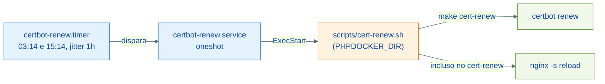

# Guia: Operação em Produção

Este repositório atende um host de produção single-node (Debian + Docker) além do desenvolvimento local. Este guia cobre o que muda entre os dois ambientes, a instalação da renovação automática de certificados e o checklist de endurecimento.

---

## Diferenças entre dev e produção

| Aspecto | Desenvolvimento local | Produção |
| --- | --- | --- |
| `ENVIRONMENT` | `staging` | `production` |
| `NGINX_PORT_HTTP` | `8099` (evita conflito com outros servers locais) | `80` |
| Imagem base dos apps | `giacomeli/makephp:8.3-dev` (ou build local) | `giacomeli/makephp:8.3-prod` |
| DNS | `/etc/hosts` via `make hosts-add-<app>` | DNS real apontando para o host |
| TLS | Sem TLS (ou staging do Let's Encrypt, `CERTBOT_STAGING=1`) | `make cert-gen` + `make enable-ssl` por site |
| Renovação de certs | Manual (`make cert-renew`) | systemd timer 2x/dia |
| Vhosts | Gerados por `build-app`/`nginx-conf` | Idem + configs hand-tuned em `conf.d/` (sem a sentinela, o `clean-confs` os preserva) |

O mesmo `docker-compose.yml` serve os dois ambientes — o que muda é o `.env` (não versionado) e o `compose.apps.yml` (gerado localmente por `make register-app`).

---

## Provisionamento do host

```bash
# Dependências: docker + compose plugin, git, make
git clone https://github.com/giacomeli/makephp ~/Projects/makephp && cd ~/Projects/makephp
make init                 # .env, rede, logs/, compose.apps.yml
# editar .env: senhas fortes, LOCAL_DIR, ENVIRONMENT=production, NGINX_PORT_HTTP=80
make build                # ou docker pull giacomeli/makephp:8.3-prod para apps
make up
make ps                   # todos os healthchecks devem ficar healthy
```

Os logs ficam em `./logs/php` e `./logs/nginx` (bind relativo criado pelo `make init`) — sem sudo e portável.

**Nota de migração (hosts provisionados antes de julho/2026):** os bind mounts de log mudaram de `/var/log/phpdocker-php` e `/var/log/phpdocker-nginx` para `./logs/`. Ao atualizar, recrie os containers (`docker compose up -d`) e ajuste qualquer logrotate/monitoramento que apontasse para os paths antigos. O compose também deixou de publicar a porta do php-fpm no host e removeu o volume `php_vendor`.

---

## HTTPS por site

Com o DNS do domínio já apontando para o host:

```bash
make cert-gen-www domain=exemplo.com.br   # emite certificado (webroot via nginx)
make enable-ssl name=exemplo              # troca o vhost para o template HTTPS
```

Detalhes do fluxo ACME em [nginx-ssl.md](./nginx-ssl.md).

---

## Renovação automática (systemd)



Instalação:

```bash
# 1. Edite systemd/certbot-renew.service: User=, Environment=PHPDOCKER_DIR=,
#    WorkingDirectory= e ExecStart= com o path real do checkout no host.
sudo cp systemd/certbot-renew.service systemd/certbot-renew.timer /etc/systemd/system/
sudo systemctl daemon-reload
sudo systemctl enable --now certbot-renew.timer
systemctl list-timers certbot-renew.timer      # conferir agendamento
journalctl -u certbot-renew.service            # logs das execucoes
```

O script `scripts/cert-renew.sh` é portátil: usa `PHPDOCKER_DIR` quando definido e cai para o diretório pai do próprio script — só o unit precisa de ajuste por host.

---

## Checklist de endurecimento

Garantido por default (não precisa de ação):

- MariaDB com autenticação obrigatória e grants por banco (sem `skip-grant-tables`, sem `GRANT ALL ON *.*` para usuário de app).
- RabbitMQ e MongoDB com credenciais do `.env`; Redis com `requirepass`.
- Versões pinadas: `mariadb:12.2`, `certbot:v5.7.0`, `timescaledb:2.28.3-pg15`, `nginx:1.29-alpine`, `mongo:6.0`.
- Nginx: `default_server` retorna 444 e rejeita handshake TLS de SNI desconhecido; security headers em todos os vhosts; cache FastCGI com bypass de sessão.
- Apenas 80/443 publicados em interface externa; infraestrutura em loopback.

Ação obrigatória por host:

1. **Trocar todas as senhas `changeme` do `.env`** antes do primeiro `make up`.
1. Usar a imagem `8.3-prod` como base dos apps (o `container_config/Dockerfile` de cada app aceita `BASE_IMAGE`).
1. Backups: volumes `mariadb_data`, `postgres_timescale_data`, `mongodb_data`, `certbot_certs` — não há rotina de backup neste repositório; provisione externamente.
1. MongoDB: se o volume de dados foi criado antes das credenciais existirem no compose, crie o usuário root manualmente (exceção de localhost do Mongo permite: `docker compose exec mongodb mongosh admin --eval 'db.createUser({user: "...", pwd: "...", roles: ["root"]})'`).
1. Revisar apps que publicam portas próprias no `compose.apps.yml` (`docker compose ps` para auditar).

---

## Operação do dia a dia

```bash
make ps                                   # estado geral + healthchecks
make logs                                 # acompanhar logs
make reload-<app>                         # reiniciar um app apos deploy
make nginx-reload-safe                    # validar vhosts e recarregar sem risco
make nginx-list                           # inventario de sites e SSL
make smoke                                # validacao completa da stack
```

`make down` é seguro (não apaga vhosts), mas derruba todos os containers — para parar um serviço específico, use `docker compose stop <serviço>`.

---

## Referências

| Arquivo | Responsabilidade |
| --- | --- |
| `systemd/certbot-renew.service`, `systemd/certbot-renew.timer` | Agendamento da renovação |
| `scripts/cert-renew.sh` | Wrapper portátil do `make cert-renew` |
| [nginx-ssl.md](./nginx-ssl.md) | Emissão de certificados e templates HTTPS |
| [arquitetura.md](./arquitetura.md) | Topologia e exposição de portas |
| [apps.md](./apps.md) | Registro de aplicações |
