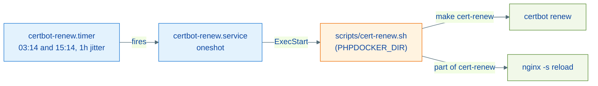

# Guide: Production Operation

This repository serves a single-node production host (Debian + Docker) in addition to local development. This guide covers what changes between the two environments, installing the automatic certificate renewal, and the hardening checklist.

---

## Dev vs production differences

| Aspect | Local development | Production |
| --- | --- | --- |
| `ENVIRONMENT` | `staging` | `production` |
| `NGINX_PORT_HTTP` | `8099` (avoids clashes with other local servers) | `80` |
| App base image | `giacomeli/makephp:8.3-dev` (or local build) | `giacomeli/makephp:8.3-prod` |
| DNS | `/etc/hosts` via `make hosts-add-<app>` | Real DNS pointing at the host |
| TLS | None (or Let's Encrypt staging, `CERTBOT_STAGING=1`) | `make cert-gen` + `make enable-ssl` per site |
| Cert renewal | Manual (`make cert-renew`) | systemd timer 2x/day |
| Vhosts | Generated by `build-app`/`nginx-conf` | Same + hand-tuned configs in `conf.d/` (no sentinel, so `clean-confs` preserves them) |

The same `docker-compose.yml` serves both environments — what changes is `.env` (unversioned) and `compose.apps.yml` (generated locally by `make register-app`).

---

## Host provisioning

```bash
# Dependencies: docker + compose plugin, git, make
git clone https://github.com/giacomeli/makephp ~/Projects/makephp && cd ~/Projects/makephp
make init                 # .env, network, logs/, compose.apps.yml
# edit .env: strong passwords, LOCAL_DIR, ENVIRONMENT=production, NGINX_PORT_HTTP=80
make build                # or docker pull giacomeli/makephp:8.3-prod for apps
make up
make ps                   # every healthcheck should turn healthy
```

Logs land in `./logs/php` and `./logs/nginx` (relative bind created by `make init`) — no sudo, fully portable.

**Migration note (hosts provisioned before July 2026):** the log bind mounts moved from `/var/log/phpdocker-php` and `/var/log/phpdocker-nginx` to `./logs/`. When upgrading, recreate the containers (`docker compose up -d`) and adjust any logrotate/monitoring pointing at the old paths. Compose also stopped publishing the php-fpm port on the host and dropped the `php_vendor` volume.

---

## HTTPS per site

With the domain's DNS already pointing at the host:

```bash
make cert-gen-www domain=example.com      # issues the certificate (webroot via nginx)
make enable-ssl name=example              # swaps the vhost for the HTTPS template
```

ACME flow details in [nginx-ssl.md](./nginx-ssl.md).

---

## Automatic renewal (systemd)



Installation:

```bash
# 1. Edit systemd/certbot-renew.service: User=, Environment=PHPDOCKER_DIR=,
#    WorkingDirectory= and ExecStart= with the real checkout path on the host.
sudo cp systemd/certbot-renew.service systemd/certbot-renew.timer /etc/systemd/system/
sudo systemctl daemon-reload
sudo systemctl enable --now certbot-renew.timer
systemctl list-timers certbot-renew.timer      # check the schedule
journalctl -u certbot-renew.service            # execution logs
```

`scripts/cert-renew.sh` itself is portable: it uses `PHPDOCKER_DIR` when set and falls back to the script's parent directory — only the unit needs per-host editing.

---

## Hardening checklist

Guaranteed by default (no action needed):

- MariaDB with enforced authentication and per-database grants (no `skip-grant-tables`, no `GRANT ALL ON *.*` for app users).
- RabbitMQ and MongoDB with credentials from `.env`; Redis with `requirepass`.
- Pinned versions: `mariadb:12.2`, `certbot:v5.7.0`, `timescaledb:2.28.3-pg15`, `nginx:1.29-alpine`, `mongo:6.0`.
- Nginx: `default_server` returns 444 and rejects TLS handshakes for unknown SNI; security headers on every vhost; FastCGI cache with session bypass.
- Only 80/443 published on external interfaces; infrastructure stays on loopback.

Mandatory per-host actions:

1. **Replace every `changeme` password in `.env`** before the first `make up`.
1. Use the `8.3-prod` image as the app base (each app's `container_config/Dockerfile` accepts `BASE_IMAGE`).
1. Backups: the `mariadb_data`, `postgres_timescale_data`, `mongodb_data` and `certbot_certs` volumes — this repository ships no backup routine; provision one externally.
1. MongoDB: if the data volume predates the credentials in compose, create the root user manually (Mongo's localhost exception allows it: `docker compose exec mongodb mongosh admin --eval 'db.createUser({user: "...", pwd: "...", roles: ["root"]})'`).
1. Review apps publishing their own ports in `compose.apps.yml` (`docker compose ps` to audit).

---

## Day-to-day operation

```bash
make ps                                   # overall status + healthchecks
make logs                                 # follow logs
make reload-<app>                         # restart an app after a deploy
make nginx-reload-safe                    # validate vhosts and reload safely
make nginx-list                           # site and SSL inventory
make smoke                                # full stack validation
```

`make down` is safe (it does not delete vhosts) but stops every container — to stop a single service, use `docker compose stop <service>`.

---

## References

| File | Responsibility |
| --- | --- |
| `systemd/certbot-renew.service`, `systemd/certbot-renew.timer` | Renewal scheduling |
| `scripts/cert-renew.sh` | Portable wrapper around `make cert-renew` |
| [nginx-ssl.md](./nginx-ssl.md) | Certificate issuance and HTTPS templates |
| [architecture.md](./architecture.md) | Topology and port exposure |
| [apps.md](./apps.md) | Application registration |
