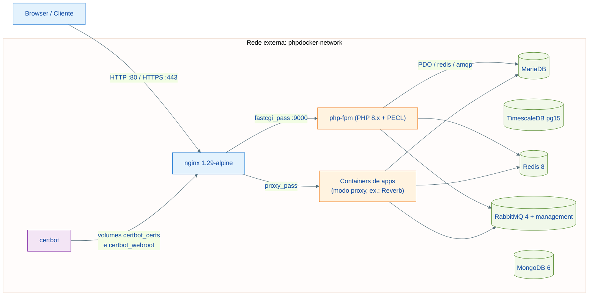
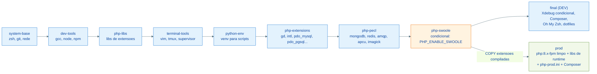
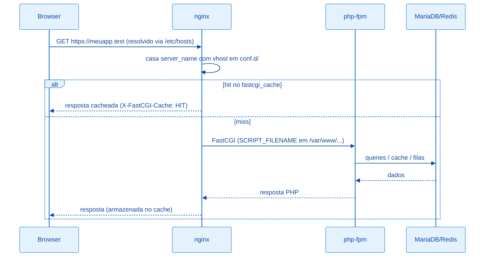

# Arquitetura: Visão Geral

Ambiente Docker orquestrado por Makefile para aplicações PHP/Laravel, projetado para servir tanto o desenvolvimento local (macOS/Linux) quanto um host de produção single-node (Debian). O princípio central:

- **A infraestrutura vive neste repositório**: bancos, cache, filas, proxy reverso e emissão de certificados.
- **As aplicações vivem em seus próprios repositórios**: cada app declara uma pasta `container_config/` (Dockerfile, entrypoint, supervisord) e é registrado no `.env` deste projeto por convenção de nomes `<APP>_*`.

---

## Topologia de serviços



A rede `phpdocker-network` é **externa** ao compose — precisa existir antes do primeiro `make up`:

```bash
docker network create phpdocker-network
```

Isso permite que containers de apps definidos em outros arquivos compose (ou manualmente) se conectem à mesma rede e resolvam os serviços pelos aliases declarados no `.env` (`MARIADB_ALIASES`, `REDIS_ALIASES`, etc.).

---

## Serviços e exposição de portas

| Serviço | Imagem | Porta no host | Observação |
| --- | --- | --- | --- |
| nginx | `nginx:1.29-alpine` | `NGINX_PORT_HTTP:80`, `NGINX_PORT_HTTPS:443` | Único ponto de entrada público; healthcheck em `/healthz` |
| php-fpm | build local `php/Dockerfile` (target `final`) | — (apenas rede interna) | Base compartilhada para sites em modo `php` |
| mariadb | build local `mariadb/` (`mariadb:12.2`) | `127.0.0.1:MARIADB_PORT` | `my.cnf` tunado; autenticação obrigatória |
| redis | `redis:8-alpine` | `127.0.0.1:REDIS_PORT` | `requirepass` via `.env`; healthcheck autenticado |
| rabbitmq | `rabbitmq:4-management` | `127.0.0.1` (5672 e 15672) | Credenciais via `RABBITMQ_USER`/`RABBITMQ_PASSWORD` |
| postgres-timescale | `timescale/timescaledb:2.28.3-pg15` | `127.0.0.1:POSTGRES_TIMESCALE_PORT` | Séries temporais; healthcheck `pg_isready` |
| mongodb | `mongo:6.0` | `127.0.0.1:MONGODB_PORT` | **Não** sobe no `make up` padrão; root user via `.env` |
| certbot | build local `certbot/` (`certbot:v5.7.0`) | — | Executado sob demanda (`make cert-gen`, `cert-renew`) |

Toda a infraestrutura fica em loopback; apenas o nginx publica em todas as interfaces. `make up` sobe `php-fpm nginx mariadb redis rabbitmq postgres-timescale` — o MongoDB é opcional (`make up mongodb`). Logs de nginx e php-fpm ficam em `./logs/` (criado pelo `make init`).

---

## Imagem PHP multi-stage (dev e prod)

O `php/Dockerfile` encadeia estágios para maximizar o cache de camadas e oferece dois targets finais: `final` (dev, completa) e `prod` (runtime enxuto que copia as extensões compiladas do builder — sem gcc, node, python ou ferramentas de terminal). A versão do PHP é build arg (`PHP_VERSION`, derivada do `PHP_IMAGE_TAG` do `.env`), e 8.3/8.4/8.5 são publicadas em `giacomeli/makephp` (`8.x-dev` / `8.x-prod`, amd64+arm64):



Pontos de atenção:

- `PHP_ENABLE_SWOOLE=true` e `PHP_ENABLE_XDEBUG=true` no `.env` controlam os estágios condicionais — o `make build` e o compose repassam os build args. Xdebug existe apenas na imagem dev; o modo em runtime vem de `XDEBUG_ENABLE` (env `XDEBUG_MODE`).
- `php.ini` por ambiente: `php/php-dev.ini` (montado no php-fpm local) e `php/php-prod.ini` (embutido no target prod, com `opcache.validate_timestamps=0`).
- A imagem prod valida no build que todas as extensoes carregam (`php -m`).

---

## Camadas de orquestração (Makefile)

O `Makefile` principal carrega o `.env`, define `SED_INPLACE` (compatibilidade macOS/Linux) e inclui três módulos:

| Módulo | Responsabilidade |
| --- | --- |
| `makefiles/php.mk` | Build das imagens (dev/prod), publicação no DockerHub, helpers por container |
| `makefiles/nginx.mk` | Build de apps, geração validada de configs Nginx, ciclo de vida de certificados |
| `makefiles/apps.mk` | `register-app`/`unregister-app` (geração do compose de apps) |
| `makefiles/system.mk` | `init`, `up`/`down`/`restart`/`logs`, `smoke`, `/etc/hosts`, limpeza |

A sintaxe de argumentos varia por alvo (posicional, sufixo com hífen, `name=`) — detalhada em [comandos.md](./comandos.md).

---

## Fluxo de uma requisição PHP



O cache FastCGI está habilitado nos templates PHP com bypass automático por cookie de sessão — páginas autenticadas nunca são servidas do cache.

---

## Referências

| Arquivo | Responsabilidade |
| --- | --- |
| `docker-compose.yml` | Definição de todos os serviços, volumes e rede |
| `php/Dockerfile` | Imagem PHP multi-stage |
| `nginx/nginx.conf` | Config global do proxy (gzip, TLS, cache, headers) |
| `Makefile` + `makefiles/*.mk` | Orquestração |
| [nginx-ssl.md](./nginx-ssl.md) | Sistema de templates e certificados |
| [apps.md](./apps.md) | Registro e ciclo de vida de aplicações |
| [producao.md](./producao.md) | Operação no host de produção |
| [comandos.md](./comandos.md) | Referência completa do Makefile |
