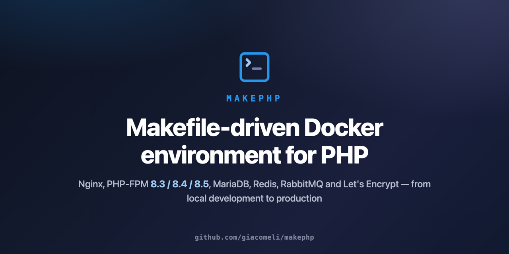

# makephp — ambiente Docker para PHP orquestrado por Makefile

<p align="center">
  
</p>

Ambiente Docker completo para aplicações PHP, orquestrado por Makefile. Um único repositório provê a infraestrutura compartilhada — Nginx, PHP-FPM, MariaDB, Redis, RabbitMQ, TimescaleDB, MongoDB e Certbot — enquanto cada aplicação vive no seu próprio repositório e é plugada por convenção de variáveis no `.env`. Serve tanto o desenvolvimento local (macOS/Linux) quanto um host de produção single-node com HTTPS automatizado.

Documentação: **English** ([readme principal](../../readme.md) e [`docs/`](../)) | **Português** (esta pasta)

## Recursos

- Imagens PHP-FPM para **8.3, 8.4 e 8.5**, cada uma em dois sabores: **dev** (extensões + zsh/Oh My Zsh, tmux, node, python, supervisor, Xdebug opcional) e **prod** (runtime enxuto com as mesmas extensões, sem toolchain) — publicadas em [hub.docker.com/u/giacomeli](https://hub.docker.com/u/giacomeli) com suporte a amd64 e arm64; troque de versão alterando o `PHP_IMAGE_TAG` no `.env`.
- Registro de aplicações sem tocar no compose: `make register-app` gera o serviço a partir do `.env`.
- Geração de vhosts Nginx a partir de templates: PHP/Laravel, proxy reverso (websockets/Reverb), estáticos e WordPress, com variantes HTTPS — validados com `nginx -t` antes de recarregar.
- Certificados Let's Encrypt via Certbot em container (webroot) com renovação automática por systemd timer.
- Nginx endurecido: TLS 1.2/1.3, security headers, cache FastCGI com bypass de sessão, catch-all que rejeita hosts e SNI desconhecidos.
- Infraestrutura exposta apenas em loopback; somente o Nginx (80/443) publica para fora. Healthchecks em todos os serviços.
- Projeto de exemplo incluído (`examples/demo-app`) e smoke test de ponta a ponta (`make smoke`).

## Documentação detalhada

| Documento | Conteúdo |
| --- | --- |
| [arquitetura.md](./arquitetura.md) | Topologia, serviços, portas, imagem PHP multi-stage (dev e prod) |
| [apps.md](./apps.md) | Como registrar e operar aplicações |
| [nginx-ssl.md](./nginx-ssl.md) | Sistema de templates Nginx e ciclo de certificados |
| [comandos.md](./comandos.md) | Referência completa do Makefile e sintaxes de argumento |
| [producao.md](./producao.md) | Deploy, renovação automática de certs e hardening |

## Requisitos

- Docker Engine + Docker Compose v2 (buildx incluso)
- GNU Make
- macOS ou Linux (o Makefile trata a diferença de `sed` automaticamente)

## Começando

```bash
git clone https://github.com/giacomeli/makephp && cd makephp
make init          # cria .env, rede Docker, pastas de log e compose.apps.yml
# edite o .env: LOCAL_DIR e senhas (os "changeme" DEVEM ser trocados)
make build         # imagem PHP base dev (demora na primeira vez)
make up            # sobe nginx, php-fpm, mariadb, redis, rabbitmq, timescaledb
make ps            # confere o estado (healthchecks)
```

O MongoDB não sobe por padrão — `make up mongodb` quando precisar. Validação completa da stack: `make smoke`.

## Imagens no DockerHub

PHP 8.3, 8.4 e 8.5, cada uma em dois sabores (todas multi-arch amd64+arm64):

| Imagem | Conteúdo | Uso |
| --- | --- | --- |
| `giacomeli/makephp:8.3-dev` / `8.4-dev` / `8.5-dev` | Extensões completas + ferramentas de desenvolvimento | Base para containers de app em dev |
| `giacomeli/makephp:8.3-prod` / `8.4-prod` / `8.5-prod` | Mesmas extensões, runtime enxuto | Base para imagens de produção |

Tags datadas (`8.x-dev-YYYYMMDD`) permitem pinar uma versão exata. Publicação: a GitHub Action `publish` (runners nativos amd64+arm64, disparo manual) ou localmente via `make push-php [PHP_VERSION=8.x]` / `make push-php-all`.

### Trocando a versão do PHP

O `PHP_IMAGE_TAG` no `.env` comanda tudo — o `make build` deriva a versão dele:

```dotenv
PHP_IMAGE_TAG=8.4-dev        # 8.3-dev | 8.4-dev | 8.5-dev
```

```bash
make build && docker compose up -d php-fpm
```

Ou pule o build local e rode o php-fpm compartilhado direto do DockerHub:

```dotenv
PHP_IMAGE=giacomeli/makephp:8.4-dev
```

## Registrando uma aplicação

1. No repositório **do app**: pasta `container_config/` com `Dockerfile`, `entrypoint.sh` e `supervisord.conf` (modelo em [`examples/demo-app/`](../../examples/demo-app/)).
1. No `.env` **deste repositório**: bloco de variáveis do app (`MEUAPP_NGINX_MODE`, `MEUAPP_CONTAINER_NAME`, `MEUAPP_PROJECT_PATH`, `MEUAPP_DOCKER_PATH`, `MEUAPP_ALIASES`, `MEUAPP_PORT`).
1. Registrar e subir:

    ```bash
    make register-app meuapp       # gera o servico no compose.apps.yml
    make build-app meuapp          # build + vhost nginx + reload validado
    make up meuapp
    sudo make hosts-add-meuapp     # aliases no /etc/hosts
    ```

Guia completo em [apps.md](./apps.md). Alvos por app usam **sufixo com hífen** (`make shell-meuapp`); `build-app`, `up`, `register-app` e `unregister-app` aceitam o nome como argumento posicional — referência em [comandos.md](./comandos.md).

## Produção

O mesmo repositório opera um host de produção: `.env` com `NGINX_PORT_HTTP=80` e senhas reais, certificados via `make cert-gen` + `make enable-ssl`, renovação automática com os units de `systemd/`, e imagem `8.x-prod` como base dos apps. Checklist de hardening e notas de migração em [producao.md](./producao.md).

## Como contribuir

Contribuições são bem-vindas — issues, docs e PRs.

1. **Converse antes em mudanças grandes**: abra uma issue descrevendo o problema ou a proposta antes de investir num PR extenso.
1. **Prepare o ambiente**: fork, clone e `make init && make build && make up`. O projeto inteiro é Makefile + shell + Docker — nenhuma outra toolchain.
1. **Valide antes de abrir o PR**: `make smoke` é o gate de regressão do projeto (exercita registro, geração de vhosts e os três modos do nginx de ponta a ponta). O CI roda `docker compose config`, render de vhosts + `nginx -t`, `hadolint` e `shellcheck` em todo PR que toca os arquivos relevantes — mudanças só de docs pulam o pipeline, e o build da imagem prod (`ci-image`) roda apenas quando `php/` muda.
1. **Convenções**: [Conventional Commits](https://www.conventionalcommits.org) (`feat:`, `fix:`, `refactor:`, `docs:`, `chore:`); código, comentários e mensagens de ferramentas em inglês; sem emojis em código ou docs. A documentação em inglês vive em `docs/` — se mudar comportamento, atualize-a (o espelho `docs/pt-br/` é mantido em sincronia pelo mantenedor, mas PRs atualizando os dois são bem-vindos).
1. **Escopo**: a infraestrutura vive aqui; lógica específica de aplicação pertence aos repositórios dos apps. Templates nginx novos, integrações de serviços e alvos de Makefile devem seguir os padrões existentes (sentinela de geração, `nginx-reload-safe`, helpers com sufixo-hífen).

## Licença

[MIT](../../LICENSE)
