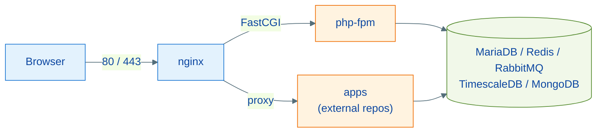

# makephp

[](https://github.com/giacomeli/makephp/actions/workflows/ci.yml) [](https://hub.docker.com/r/giacomeli/makephp) [](./LICENSE)

A complete, Makefile-driven Docker environment for PHP applications. A single repository provides the shared infrastructure — Nginx, PHP-FPM, MariaDB, Redis, RabbitMQ, TimescaleDB, MongoDB and Certbot — while each application lives in its own repository and plugs in through a `.env` variable convention. It serves both local development (macOS/Linux) and a single-node production host with automated HTTPS.

Documentation: **English** (below and in [`docs/`](./docs/)) | **Português** ([`docs/pt-br/`](./docs/pt-br/readme.md))

## Features

- PHP-FPM images for **8.3, 8.4 and 8.5**, each in two flavors: **dev** (all extensions + zsh/Oh My Zsh, tmux, node, python, supervisor, optional Xdebug) and **prod** (slim runtime with the same extensions, no toolchain) — published at [hub.docker.com/u/giacomeli](https://hub.docker.com/u/giacomeli) for amd64 and arm64; switch versions by changing `PHP_IMAGE_TAG` in `.env`.
- App registration without touching compose: `make register-app` generates the service from `.env`.
- Nginx vhost generation from templates: PHP/Laravel, reverse proxy (websockets/Reverb), static and WordPress, with HTTPS variants — validated with `nginx -t` before every reload.
- Let's Encrypt certificates via containerized Certbot (webroot) with automatic renewal through a systemd timer.
- Hardened Nginx: TLS 1.2/1.3, security headers, FastCGI cache with session bypass, catch-all rejecting unknown hosts and SNI.
- Infrastructure exposed on loopback only; just Nginx (80/443) publishes externally. Healthchecks on every service.
- Bundled example project (`examples/demo-app`) and an end-to-end smoke test (`make smoke`).

## Architecture



Detailed documentation in [`docs/`](./docs/):

| Document | Contents |
| --- | --- |
| [docs/architecture.md](./docs/architecture.md) | Topology, services, ports, multi-stage PHP image (dev and prod) |
| [docs/apps.md](./docs/apps.md) | How to register and operate applications |
| [docs/nginx-ssl.md](./docs/nginx-ssl.md) | Nginx template system and certificate lifecycle |
| [docs/commands.md](./docs/commands.md) | Full Makefile reference and argument syntaxes |
| [docs/production.md](./docs/production.md) | Deployment, automatic cert renewal and hardening |

## Requirements

- Docker Engine + Docker Compose v2 (buildx included)
- GNU Make
- macOS or Linux (the Makefile handles the `sed` differences automatically)

## Getting started

```bash
git clone https://github.com/giacomeli/makephp && cd makephp
make init          # creates .env, Docker network, log dirs and compose.apps.yml
# edit .env: LOCAL_DIR and passwords (every "changeme" MUST be replaced)
make build         # dev PHP base image (slow on the first run)
make up            # starts nginx, php-fpm, mariadb, redis, rabbitmq, timescaledb
make ps            # check status (healthchecks)
```

MongoDB does not start by default — `make up mongodb` when you need it.

Full stack validation with the example app:

```bash
make smoke
```

## DockerHub images

PHP 8.3, 8.4 and 8.5, each in two flavors (all multi-arch amd64+arm64):

| Image | Contents | Use |
| --- | --- | --- |
| `giacomeli/makephp:8.3-dev` / `8.4-dev` / `8.5-dev` | All extensions + development tooling | Base for app containers in dev |
| `giacomeli/makephp:8.3-prod` / `8.4-prod` / `8.5-prod` | Same extensions, slim runtime | Base for production images |

```dockerfile
# An app Dockerfile (e.g. container_config/Dockerfile)
ARG BASE_IMAGE=giacomeli/makephp:8.4-dev
FROM ${BASE_IMAGE}
```

Dated tags (`8.x-dev-YYYYMMDD`) allow pinning an exact build. Publishing: the `publish` GitHub Action (native amd64+arm64 runners, manual dispatch) or locally via `make push-php [PHP_VERSION=8.x]` / `make push-php-all`.

### Switching PHP versions

The `PHP_IMAGE_TAG` in `.env` drives everything — `make build` derives the PHP version from it:

```dotenv
PHP_IMAGE_TAG=8.4-dev        # 8.3-dev | 8.4-dev | 8.5-dev
```

```bash
make build && docker compose up -d php-fpm
```

Or skip the local build entirely and run the shared php-fpm straight from DockerHub:

```dotenv
PHP_IMAGE=giacomeli/makephp:8.4-dev
```

## Registering an application

1. In the **app's** repository: a `container_config/` folder with `Dockerfile`, `entrypoint.sh` and `supervisord.conf` (template in [`examples/demo-app/`](./examples/demo-app/)).
1. In **this** repository's `.env`: the app variable block.

    ```dotenv
    MYAPP_NGINX_MODE=proxy         # php | proxy | html | none
    MYAPP_CONTAINER_NAME=myapp
    MYAPP_PROJECT_PATH=/absolute/path/to/myapp
    MYAPP_DOCKER_PATH=/var/www
    MYAPP_ALIASES="myapp.test"
    MYAPP_PORT=8000
    ```

1. Register and start:

    ```bash
    make register-app myapp        # generates the service in compose.apps.yml
    make build-app myapp           # build + nginx vhost + validated reload
    make up myapp
    sudo make hosts-add-myapp      # aliases in /etc/hosts
    ```

Complete guide (modes, vhost root, how apps see the infrastructure) in [docs/apps.md](./docs/apps.md).

## Essential commands

| Command | Action |
| --- | --- |
| `make init` | Onboarding: .env, network, logs, compose.apps.yml |
| `make up` / `make down` | Start / stop the infrastructure (down preserves vhosts) |
| `make register-app <app>` / `make build-app <app>` | Register and build an app |
| `make shell-<container>` | zsh shell inside the container |
| `make artisan-<container>` / `make composer-<container>` | Laravel artisan / Composer |
| `make nginx-list` | Site inventory and SSL status |
| `make cert-gen domain=example.com` | Issue a Let's Encrypt certificate |
| `make enable-ssl name=site` | Move a vhost to HTTPS |
| `make smoke` | Validate the stack end to end |
| `make clean-confs` | Remove only generated vhosts (preserves manual ones) |

Per-app targets use a **dash suffix** (`make shell-myapp`); `build-app`, `up`, `register-app` and `unregister-app` take the name as a positional argument. Full reference in [docs/commands.md](./docs/commands.md).

## Production

The same repository runs a production host: `.env` with `NGINX_PORT_HTTP=80` and real passwords, certificates via `make cert-gen` + `make enable-ssl`, automatic renewal with the `systemd/` units, and the `8.x-prod` image as the app base. Hardening checklist and migration notes in [docs/production.md](./docs/production.md).

## Contributing

Contributions are welcome — issues, docs and PRs.

1. **Discuss first for larger changes**: open an issue describing the problem or proposal before investing in a big PR.
1. **Set up your environment**: fork, clone, then `make init && make build && make up`. The whole project is Makefile + shell + Docker — no other toolchain.
1. **Validate before opening the PR**: `make smoke` is the project's regression gate (it exercises registration, vhost generation and the three nginx modes end to end). CI also runs `docker compose config`, vhost rendering + `nginx -t`, `hadolint`, `shellcheck` and the prod image build on every PR.
1. **Conventions**: [Conventional Commits](https://www.conventionalcommits.org) (`feat:`, `fix:`, `refactor:`, `docs:`, `chore:`); code, comments and tool messages in English; no emojis in code or docs. English docs live in `docs/` — if you change behavior, update them (the `docs/pt-br/` mirror is kept in sync by the maintainer, but PRs updating both are appreciated).
1. **Scope**: infrastructure lives here; application-specific logic belongs in app repositories. New nginx templates, service integrations and Makefile targets should follow the existing patterns (generation sentinel, `nginx-reload-safe`, dash-suffix helpers).

## License

[MIT](./LICENSE)
